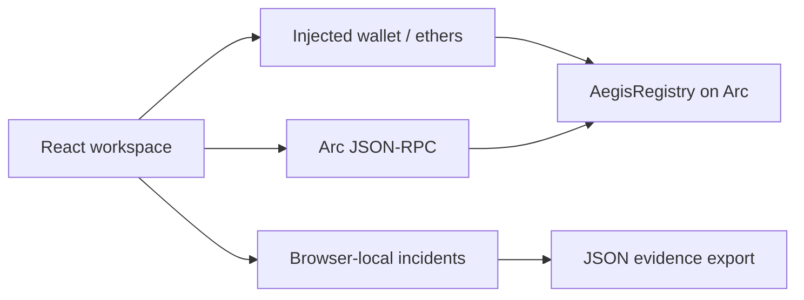

# Aegis Protocol

Wallet-security workspace and onchain evidence registry on **Arc Testnet** (chain ID 5042002). Users screen addresses, publish wallet-signed allegations backed by evidence hashes, dispute them, and receive delayed adjudication from a trusted reviewer.

> Testnet software. The registry contract has not been independently audited. See [SECURITY.md](SECURITY.md) before any mainnet use.

## Contracts

| Version | Source | Status |
| --- | --- | --- |
| **v2** (current) | [`contracts/AegisRegistry.sol`](contracts/AegisRegistry.sol) | Ready to deploy. The frontend deploys and reads it. |
| v1 (legacy) | [`contracts/legacy/AegisRegistryV1.sol`](contracts/legacy/AegisRegistryV1.sol) | Live at `0x5eD536a9a2856109E4a02016ad2a99B3865e91F0`; bytecode verified against the frozen artifact `src/registry-v1-artifact.json`. |

The frontend detects the version of the configured registry at runtime (`VERSION()`), so the live v1 deployment keeps working until you switch to a v2 address.

### v2 hardening over v1

- **Complete per-address history**: onchain `reportIdsOf` index and O(1) `subjectSummary` counters. The scanner covers every report, not just the latest 100.
- **Paginated reads**: `getReports(offset, limit)` (max 100 per page) replaces one RPC call per report.
- **Two-step reviewer rotation** (`transferReviewer` → `acceptReviewer`), so the reviewer can migrate to a multisig without risking a typo.
- **Emergency pause**: blocks submissions and challenges. Adjudication continues while paused.
- **Abuse controls**: one open report per (reporter, subject); no self-reports; reporters cannot challenge their own report; bounds-checked IDs.
- **Custom errors**, decoded in the UI into readable messages.
- **Richer events**: indexed reporter, optional `evidenceURI` (≤256 bytes), resolver address. Reports record `resolvedAt` and `challengeCount`.
- Exact compiler pin (`0.8.38`, `paris` EVM, optimizer 200 runs) and a size check (EIP-170).

## Quick start

Node.js 22+.

```sh
npm ci
npm run dev
```

Open **Onchain platform**. The configured registry loads automatically. Connect a MetaMask-compatible wallet to submit, challenge or resolve reports. No private key is ever handled by this app.

### Local chain (no wallet funds needed)

```sh
node scripts/local-chain.mjs
```

This starts a Ganache chain on `127.0.0.1:8545` with Arc's chain ID, deploys v2 and seeds sample reports. Run the app against it with `VITE_ARC_RPC_URL=http://127.0.0.1:8545` and `VITE_REGISTRY_ADDRESS=<printed address>`. Never expose it publicly.

## Scripts

| Command | Purpose |
| --- | --- |
| `npm test` | Risk-engine unit tests |
| `npm run test:contracts` | v1 + v2 contract lifecycle, access control, pause, rotation and pagination tests on an ephemeral EVM |
| `npm run contracts:compile` | Compile v2 → `src/registry-artifact.json` and `artifacts/AegisRegistry.v2.standard-input.json`; prove v1 source still matches the frozen artifact |
| `npm run build` | Compile + production bundle in `dist/` (React/ethers split into separate chunks) |
| `npm run deploy:check -- <deployer> <reviewer>` | Read-only balance and gas estimate for a v2 deployment |
| `npm run deploy:verify -- <txHash> <deployer> <reviewer> [--write]` | Verify a deployment against the repository artifacts; `--write` records it in `src/deployment.json` |

CI (`.github/workflows/ci.yml`) runs compilation with an artifact-drift check, all tests, the build and `npm audit --omit=dev`.

## Architecture



- `src/chain.js`: chain config, wallet connection, version detection, paginated reads, subject lookup, error decoding, transaction simulation and sending.
- `src/Onchain.jsx`: registry dashboard, report/challenge/resolve forms, reviewer administration, deployment.
- `src/main.jsx`: workspace shell, scanner, local incident tooling.
- `src/risk.js`: local screening policy.
- `scripts/`: compile, tests, deployment check/verify, local chain.

## Deploying to production hosting

See [SETUP.md](SETUP.md). Summary: build with `npm run build` and serve `dist/` over HTTPS. Security headers (CSP, HSTS, framing protection) ship in `public/_headers` (Netlify/Cloudflare Pages) and `vercel.json`. If you change `VITE_ARC_RPC_URL`, add its origin to `connect-src`.

## Known limitations

- Reports are allegations. The reviewer is a single trusted role; use a multisig. There is no decentralized governance or staking.
- Evidence text stays offchain. Only hashes and optional URIs are published, so reporters must preserve exact copies.
- Recovery incidents are browser-local. IPFS pinning, transaction simulation, fund tracing and issuer coordination are not implemented.
- The local EVM tooling (Ganache) is a dev dependency with known advisories. It is not shipped in the browser bundle.

## Arkiv report storage

Community reports and Threat registry use Arkiv Rabdi for public address/evidence storage. Arc remains the authoritative adjudication contract. See [ARKIV_SETUP.md](ARKIV_SETUP.md) for the two signed transactions, funding, expiry and recovery steps. PostgreSQL is not required. Recovery incidents remain browser-local. Live Arkiv writes await test tGLM and a wallet signature.
