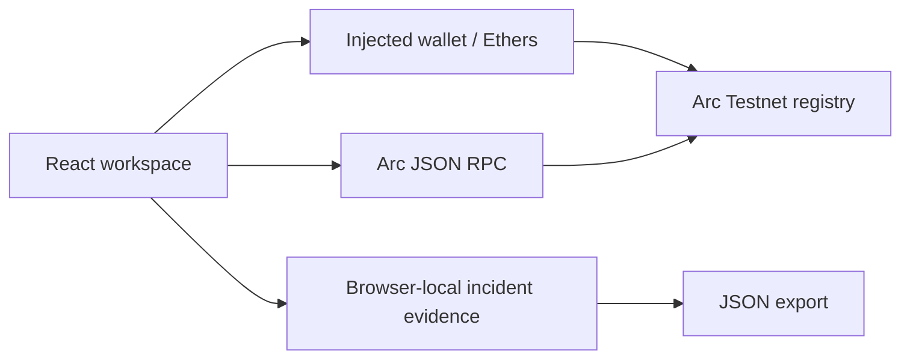

# Aegis Protocol

Wallet security and onchain evidence registry for Arc Testnet. This is a testnet application under development, not an audited production security service.

## Verified Arc Testnet deployment

Registry: `0x5eD536a9a2856109E4a02016ad2a99B3865e91F0`. The frontend uses this shared registry by default. Deployment metadata is recorded in `src/deployment.json`; `VITE_REGISTRY_ADDRESS` can override it. Creation bytecode and constructor arguments were checked against the confirmed transaction. This is not an explorer source-code verification or independent audit.

## Start

Use Node.js 22 LTS or newer.

```sh
npm ci
npm run dev
```

Open the local URL, select **Onchain platform**, and follow [SETUP.md](SETUP.md). The injected wallet integration supports MetaMask-compatible providers. No private key is needed by this app.

## Implemented

- Real injected wallet account access and Arc Testnet network switch/add.
- Account/network change listeners clear stale wallet display state.
- USDC gas balance display using native 18-decimal units.
- Browser-wallet deployment of compiled registry bytecode with a chosen reviewer.
- Signed report submission, evidence-hash challenges and reviewer resolution.
- Transaction simulation through `eth_call` before registry writes, transaction links and receipt confirmation.
- Shared onchain report reads; scanner consults the configured registry's latest 100 records.
- Local incident forms, evidence records and JSON exports.
- Deterministic local screening fixtures remain explicitly demo data.

Transaction static calls check whether a registry operation would revert. They are not a token-transfer security simulation service.

## Tests

```sh
npm test
npm run contracts:compile
npm run test:contracts
npm run build
```

The contract test deploys to an ephemeral Ganache chain and checks submission validation, reviewer access, review delay, duplicate challenges, resolution and closed-report protections. Ganache may fall back to its JS implementation on newer Node versions. The fallback still executes the tests. Testnet wallet interaction and browser layout have not been automated or visually verified in this environment.

## Architecture



- `src/chain.js`: chain configuration, wallet connection, contract reads and deployment.
- `src/Onchain.jsx`: wallet and onchain lifecycle interface.
- `src/risk.js`: local screening policy.
- `contracts/AegisRegistry.sol`: report, challenge and trusted-reviewer adjudication.
- `scripts/compile.mjs`: Solidity compilation and frontend ABI/bytecode generation.
- `scripts/contracts.test.mjs`: local EVM lifecycle tests.

## Trust and remaining production work

Registry reports are public allegations, not automatic proof of fraud. The immutable reviewer can confirm or reject after a two-day review period; this is trusted adjudication, not decentralized governance. Challenges are public hashes, with no economic staking yet. Evidence text is not published by this app, so preserve exact copies independently. Never put private keys, seed phrases or sensitive victim information into evidence.

Shared reads currently show the latest 100 reports; the scanner cannot assert the absence of older reports. A production deployment needs a paginated indexer with finality/reorg handling, comprehensive threat intelligence and token-transfer simulation. Unavailable reads produce an error rather than a safe verdict.

Recovery incidents remain browser-local. IPFS storage, authenticated durable incident storage, fund tracing, USDC staking and authorized issuer coordination are not implemented. Only authorized issuers can freeze eligible funds. Recovery is never guaranteed.

Before mainnet use: independent contract audit, broader adversarial/invariant testing, reviewed governance and reviewer key rotation design, abuse controls, durable encrypted evidence storage, monitoring, incident runbooks, dependency remediation and a professional security review. Keep this deployment on testnet until these are complete.

Dependency review: npm audit reported advisories in the Ganache test-tool dependency tree, including high/critical findings. Ganache is a development dependency and is not imported into the browser bundle, but these findings still require remediation or replacement of the local EVM tooling before treating the repository as production hardened. Do not expose Ganache as a public service.

## Arkiv public report storage

Community reports and Threat registry now use the Arkiv SDK on Rabdi. See [ARKIV_SETUP.md](ARKIV_SETUP.md) for token funding, two signed transactions, retry/export steps, expiry and validation limits. PostgreSQL is not required. The earlier browser-local reporting description is superseded for these two screens; recovery incidents remain local. The Arc scanner still inspects the latest 100 Arc records and does not claim complete threat coverage.
