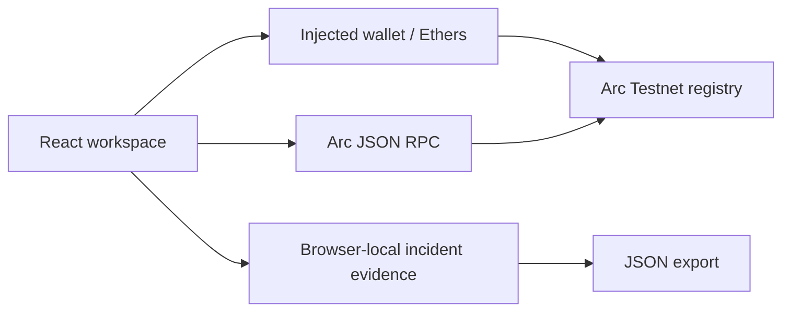

# Aegis Protocol

Wallet security and onchain evidence registry for Arc Testnet. This is a testnet application under development, not an audited production security service.

## Verified Arc Testnet deployment

Registry: `0x5eD536a9a2856109E4a02016ad2a99B3865e91F0`. The frontend uses this shared registry by default. Deployment metadata is recorded in `src/deployment.json`; `VITE_REGISTRY_ADDRESS` can override it. Creation bytecode and constructor arguments were checked against the confirmed transaction. This is not an explorer source-code verification or independent audit.

## Start

Use Node.js 22 LTS or newer.

```sh
npm ci
npm run dev
```

Open the local URL, select **Onchain platform**, and follow [SETUP.md](SETUP.md). The injected wallet integration supports MetaMask-compatible providers. No private key is needed by this app.

## Implemented

- Real injected wallet account access and Arc Testnet network switch/add.
- Account/network change listeners clear stale wallet display state.
- USDC gas balance display using native 18-decimal units.
- Browser-wallet deployment of compiled registry bytecode with a chosen reviewer.
- Signed report submission, evidence-hash challenges and reviewer resolution.
- Transaction simulation through `eth_call` before registry writes, transaction links and receipt confirmation.
- Shared onchain report reads; scanner consults the configured registry's latest 100 records.
- Local incident forms, evidence records and JSON exports.
- Deterministic local screening fixtures remain explicitly demo data.

Transaction static calls check whether a registry operation would revert. They are not a token-transfer security simulation service.

## Tests

```sh
npm test
npm run contracts:compile
npm run test:contracts
npm run build
```

The contract test deploys to an ephemeral Ganache chain and checks submission validation, reviewer access, review delay, duplicate challenges, resolution and closed-report protections. Ganache may fall back to its JS implementation on newer Node versions. The fallback still executes the tests. Testnet wallet interaction and browser layout have not been automated or visually verified in this environment.

## Architecture



- `src/chain.js`: chain configuration, wallet connection, contract reads/writes, deployment and error mapping.
- `src/main.jsx`, `src/App.jsx`: entry point, providers and hash routing.
- `src/state/`: wallet, registry, toast and transaction (simulate → sign → confirm) state.
- `src/components/`: layout shell, UI primitives, scanner and evidence verifier.
- `src/pages/`: Home, Scam checker, Learn, I've been scammed (emergency flow), My cases, Helplines & resources, Threat registry, Submit report, Challenge & review, Deploy, Trust & architecture.
- `src/lib/heuristics.js`: on-device scam-signal rules for messages, links, phone numbers and UPI IDs (tested in `src/heuristics.test.js`).
- `src/data/resources.js`: the only place helpline contacts come from (see below).
- `src/risk.js`: local screening policy.
- `contracts/AegisRegistry.sol`: report, challenge and trusted-reviewer adjudication.
- `scripts/compile.mjs`: Solidity compilation and frontend ABI/bytecode generation.
- `scripts/contracts.test.mjs`: local EVM lifecycle tests.

## Trust and remaining production work

Registry reports are public allegations, not automatic proof of fraud. The immutable reviewer can confirm or reject after a two-day review period; this is trusted adjudication, not decentralized governance. Challenges are public hashes, with no economic staking yet. Evidence text is not published by this app, so preserve exact copies independently. Never put private keys, seed phrases or sensitive victim information into evidence.

Shared reads currently show the latest 100 reports; the scanner cannot assert the absence of older reports. A production deployment needs a paginated indexer with finality/reorg handling, comprehensive threat intelligence and token-transfer simulation. Unavailable reads produce an error rather than a safe verdict.

Recovery incidents remain browser-local. IPFS storage, authenticated durable incident storage, fund tracing, USDC staking and authorized issuer coordination are not implemented. Only authorized issuers can freeze eligible funds. Recovery is never guaranteed.

Before mainnet use: independent contract audit, broader adversarial/invariant testing, reviewed governance and reviewer key rotation design, abuse controls, durable encrypted evidence storage, monitoring, incident runbooks, dependency remediation and a professional security review. Keep this deployment on testnet until these are complete.

Dependency review: npm audit reported advisories in the Ganache test-tool dependency tree, including high/critical findings. Ganache is a development dependency and is not imported into the browser bundle, but these findings still require remediation or replacement of the local EVM tooling before treating the repository as production hardened. Do not expose Ganache as a public service.

## Interface (ui-upgrade)

A futuristic, calm interface for everyday users, including non-technical and older users on phones. Dark glass panels, one trust colour (teal) and consistent status colours: **green = safe, amber = suspicious, red = danger**.

### Setup

```sh
npm ci
npm run dev        # http://127.0.0.1:5173
npm test           # risk + scam-signal rule tests
npm run build
node scripts/figures/inspection-gate.mjs   # rebuild the isometric "how it works" figure
```

Stack (unchanged): Vite 6 + React 19 + JSX + plain CSS. The upgrade adds:

| Package | Why |
|---|---|
| `tailwindcss` 4 + `@tailwindcss/vite` | Required by Vengeance UI components. Preflight is **not** loaded, so existing CSS keeps control of base styles. |
| `framer-motion` | Motion base for all animation (Vengeance components import it). |
| `clsx`, `tailwind-merge` | The `cn()` helper shadcn components expect (`src/lib/utils.js`). |
| `tesseract.js` | Reads text from screenshots **in the browser**. Lazy-loaded only when a screenshot is checked; it downloads its OCR engine and English data from a CDN on first use. |

GSAP and Lenis were deliberately not added: nothing needs GSAP, and smooth-scroll hijacking hurts older users and screen-reader users.

### Screens

| Route | Screen |
|---|---|
| `#/overview` | Landing: hero, live registry counters, how it works, trust promise |
| `#/scanner` | Scam checker: message, link, phone/UPI, wallet address, screenshot |
| `#/recovery` | Emergency flow: calm checklist with saved progress + incident form |
| `#/cases` | Case tracker: timeline per incident with live registry status |
| `#/learn` | Education hub: scam types bento grid |
| `#/help` | Helplines & resources (verified entries only) |

The scam checker's rules are transparent pattern checks, not a threat-intelligence lookup. A "Looks safe" result means none of the known warning signs matched. Wallet addresses keep the original registry logic and never return "safe" (only "No record").

### Helplines: how to add verified contacts

`src/data/resources.js` ships **empty on purpose**. No contact details exist anywhere else in the code, and none were invented. Add an entry only after checking it on an official source (for example a `.gov.in` page), and record `source` and `verifiedOn`. The Resources page renders large `tel:` buttons automatically.

### Where each source was used

| Source | Used for | How it was installed | License / attribution |
|---|---|---|---|
| [Vengeance UI](https://www.vengenceui.com/) | `spotlight-navbar` (floating nav), `stagger-text` (split headings), `stats-counter` (landing counters), `glow-border-card` (verdict card), `flip-fade-text` (radar status words), `perspective-grid` (hero background), `faq-accordion` (emergency + helpline FAQs), `expandable-bento-grid` (Education hub) | shadcn CLI with the `@vengeanceui` registry in `components.json` → `src/components/vengeance/` | **MIT © Ashutoshx7.** Each file keeps an attribution header. Adapted for Vite and accessibility (notes in file headers). The `glow-conic` CSS is copied from the Vengeance repo and attributed in `src/styles/aegis.css`. |
| [Anatomy](https://github.com/wheresryan22/anatomy) | Isometric "how it works" figure (`public/figures/inspection-gate.svg`) | Kit vendored in `scripts/figures/vendor/anatomy/` (with `LICENSE` and `VERSION` commit), figure built by `scripts/figures/inspection-gate.mjs` | **MIT © 2026 Ryan.** Keep `vendor/anatomy/LICENSE`. |
| [AnimMasterLib](https://animmasterlib.dev/) | **Not used.** | — | Paid only. Its terms forbid redistributing source, which is incompatible with this public repo. |
| [Skiper UI](https://skiper-ui.com/) | **Not used.** | — | Its terms forbid copying/redistribution, and almost all components are paid. |

Custom pieces (no source offers them): the cursor system, radar sweep, scramble text, timeline, calm progress ring and scam-signal rules.

### Motion and cursor

- `src/motion/config.js` is the single source for easings, durations, springs and staggers. `CALM_ROUTES` (`recovery`, `cases`) only get slow, translation-free motion.
- `src/components/motion/`: `Reveal`, `RevealGroup`/`RevealItem` (intro sequences), `SplitHeading`, `Scramble`, `PageTransition`, `ScrollProgress`, `Parallax`.
- `src/components/cursor/`: dot + spring ring with link/text/media/drag/scanning states, click pulse, card spotlight and magnetic buttons (`useMagnetic`, on by default for large primary buttons, or `<Button magnetic>`). Any element can force a state with `data-cursor="link|text|media|drag|native"`.
- Reduced motion: `<MotionConfig reducedMotion="user">` plus explicit fallbacks. The custom cursor, magnetic pull, scramble, radar sweep and glow rotation all switch off. Touch devices never get the custom cursor, and inputs always keep the native cursor.

### Customization guide

- **Colours, radii, glow, spacing, easing:** edit `src/styles/tokens.css`. Tailwind sees the same values through `@theme` in `src/styles/tailwind.css` (`bg-surface`, `text-safe`, `rounded-lg`…).
- **Fonts:** `--font` / `--mono` in tokens, plus the Google Fonts link in `index.html`.
- **Motion feel:** `src/motion/config.js` (for example, slow everything down by raising `duration.*`).
- **Scam rules:** `src/lib/heuristics.js`. Add a test in `src/heuristics.test.js` for every new rule.
- **Scam types (Education hub):** the `TYPES` array in `src/pages/Learn.jsx`.
- **Emergency checklist steps:** `STEPS` in `src/pages/Recovery.jsx`.
- **More Vengeance components:** `npx shadcn@latest add @vengeanceui/<name>` (lands in `src/components/ui/`, so move it to `src/components/vengeance/`). If it uses `dark:` classes, it works automatically: `<html class="dark">`.

### Known limitations

- Lighthouse scores and a screen-reader pass have not been measured in this environment. Keyboard navigation, focus states and 375px layouts were checked manually.
- The Anatomy figure is a static "Figure"-tier drawing. Anatomy's geometry audit and line-end checks (which need headless Chrome tooling) were not run.
- The public Arc RPC sometimes rate-limits registry reads (HTTP 429). The UI then shows the registry as unavailable rather than any safe verdict.
