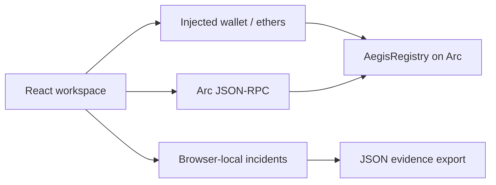

# Aegis Protocol

Wallet-security workspace and onchain evidence registry on **Arc Testnet** (chain ID 5042002). Users screen addresses, publish wallet-signed allegations backed by evidence hashes, dispute them, and receive delayed adjudication from a trusted reviewer.

> Testnet software. The registry contract has not been independently audited. See [SECURITY.md](SECURITY.md) before any mainnet use.

## Contracts

| Version | Source | Status |
| --- | --- | --- |
| **v2** (current) | [`contracts/AegisRegistry.sol`](contracts/AegisRegistry.sol) | Ready to deploy. The frontend deploys and reads it. |
| v1 (legacy) | [`contracts/legacy/AegisRegistryV1.sol`](contracts/legacy/AegisRegistryV1.sol) | Live at `0x5eD536a9a2856109E4a02016ad2a99B3865e91F0`; bytecode verified against the frozen artifact `src/registry-v1-artifact.json`. |

The frontend detects the version of the configured registry at runtime (`VERSION()`), so the live v1 deployment keeps working until you switch to a v2 address.

### v2 hardening over v1

- **Complete per-address history**: onchain `reportIdsOf` index and O(1) `subjectSummary` counters. The scanner covers every report, not just the latest 100.
- **Paginated reads**: `getReports(offset, limit)` (max 100 per page) replaces one RPC call per report.
- **Two-step reviewer rotation** (`transferReviewer` → `acceptReviewer`), so the reviewer can migrate to a multisig without risking a typo.
- **Emergency pause**: blocks submissions and challenges. Adjudication continues while paused.
- **Abuse controls**: one open report per (reporter, subject); no self-reports; reporters cannot challenge their own report; bounds-checked IDs.
- **Custom errors**, decoded in the UI into readable messages.
- **Richer events**: indexed reporter, optional `evidenceURI` (≤256 bytes), resolver address. Reports record `resolvedAt` and `challengeCount`.
- Exact compiler pin (`0.8.38`, `paris` EVM, optimizer 200 runs) and a size check (EIP-170).

## Quick start

Node.js 22+.

```sh
npm ci
npm run dev
```

Open **Onchain platform**. The configured registry loads automatically. Connect a MetaMask-compatible wallet to submit, challenge or resolve reports. No private key is ever handled by this app.

### Local chain (no wallet funds needed)

```sh
node scripts/local-chain.mjs
```

This starts a Ganache chain on `127.0.0.1:8545` with Arc's chain ID, deploys v2 and seeds sample reports. Run the app against it with `VITE_ARC_RPC_URL=http://127.0.0.1:8545` and `VITE_REGISTRY_ADDRESS=<printed address>`. Never expose it publicly.

## Scripts

| Command | Purpose |
| --- | --- |
| `npm test` | Risk-engine unit tests |
| `npm run test:contracts` | v1 + v2 contract lifecycle, access control, pause, rotation and pagination tests on an ephemeral EVM |
| `npm run contracts:compile` | Compile v2 → `src/registry-artifact.json` and `artifacts/AegisRegistry.v2.standard-input.json`; prove v1 source still matches the frozen artifact |
| `npm run build` | Compile + production bundle in `dist/` (React/ethers split into separate chunks) |
| `npm run deploy:check -- <deployer> <reviewer>` | Read-only balance and gas estimate for a v2 deployment |
| `npm run deploy:verify -- <txHash> <deployer> <reviewer> [--write]` | Verify a deployment against the repository artifacts; `--write` records it in `src/deployment.json` |

CI (`.github/workflows/ci.yml`) runs compilation with an artifact-drift check, all tests, the build and `npm audit --omit=dev`.

## Architecture



- `src/chain.js`: chain config, wallet connection, v1/v2 version detection, paginated reads, subject lookup, error decoding, transaction simulation and sending. A small helper section at the end serves the redesigned pages.
- `src/main.jsx`, `src/App.jsx`: entry point, providers and hash routing.
- `src/state/`: wallet, registry, toast and transaction (check & sign → confirm) state. Registry writes go through `sendRegistryTx`.
- `src/components/`: layout shell, UI primitives, scanner and evidence verifier.
- `src/pages/`: Home, Scam checker, Learn, I've been scammed (emergency flow), My cases, Helplines & resources, Threat registry, Submit report, Challenge & review, Arkiv evidence, Onchain workspace, Deploy, Trust & architecture.
- `src/Onchain.jsx`: full operator panel (report/challenge/resolve, v2 pause and reviewer rotation, deployment), shown at `#/onchain`.
- `src/ArkivReports.jsx`, `src/arkiv.js`: Arc + Arkiv evidence flow, shown at `#/arkiv`.
- `src/lib/heuristics.js`: on-device scam-signal rules for messages, links, phone numbers and UPI IDs (tested in `src/heuristics.test.js`).
- `src/data/resources.js`: the only place helpline contacts come from (see below).
- `src/risk.js`: local screening policy.
- `scripts/`: compile, tests, deployment check/verify, local chain.

## Deploying to production hosting

See [SETUP.md](SETUP.md). Summary: build with `npm run build` and serve `dist/` over HTTPS. Security headers (CSP, HSTS, framing protection) ship in `public/_headers` (Netlify/Cloudflare Pages) and `vercel.json`. If you change `VITE_ARC_RPC_URL`, add its origin to `connect-src`.

## Known limitations

- Reports are allegations. The reviewer is a single trusted role; use a multisig. There is no decentralized governance or staking.
- Evidence text stays offchain. Only hashes and optional URIs are published, so reporters must preserve exact copies.
- Recovery incidents are browser-local. IPFS pinning, transaction simulation, fund tracing and issuer coordination are not implemented.
- The local EVM tooling (Ganache) is a dev dependency with known advisories. It is not shipped in the browser bundle.

## Arkiv report storage

The Arkiv evidence page (`#/arkiv`) uses Arkiv Rabdi for public address/evidence storage. Arc remains the authoritative adjudication contract. See [ARKIV_SETUP.md](ARKIV_SETUP.md) for the two signed transactions, funding, expiry and recovery steps. PostgreSQL is not required. Recovery incidents remain browser-local. Live Arkiv writes await test tGLM and a wallet signature.

Dependency review: npm audit reported advisories in the Ganache test-tool dependency tree, including high/critical findings. Ganache is a development dependency and is not imported into the browser bundle, but these findings still require remediation or replacement of the local EVM tooling before treating the repository as production hardened. Do not expose Ganache as a public service.

## Interface (ui-upgrade)

A futuristic, calm interface for everyday users, including non-technical and older users on phones. Dark glass panels, one trust colour (teal) and consistent status colours: **green = safe, amber = suspicious, red = danger**.

### Setup

```sh
npm ci
npm run dev        # http://127.0.0.1:5173
npm test           # risk + scam-signal rule tests
npm run build
node scripts/figures/inspection-gate.mjs   # rebuild the isometric "how it works" figure
```

Stack (unchanged): Vite 6 + React 19 + JSX + plain CSS. The upgrade adds:

| Package | Why |
|---|---|
| `tailwindcss` 4 + `@tailwindcss/vite` | Required by Vengeance UI components. Preflight is **not** loaded, so existing CSS keeps control of base styles. |
| `framer-motion` | Motion base for all animation (Vengeance components import it). |
| `clsx`, `tailwind-merge` | The `cn()` helper shadcn components expect (`src/lib/utils.js`). |
| `tesseract.js` | Reads text from screenshots **in the browser**. Lazy-loaded only when a screenshot is checked; it downloads its OCR engine and English data from a CDN on first use. |

GSAP and Lenis were deliberately not added: nothing needs GSAP, and smooth-scroll hijacking hurts older users and screen-reader users.

### Screens

| Route | Screen |
|---|---|
| `#/overview` | Landing: hero, live registry counters, how it works, trust promise |
| `#/scanner` | Scam checker: message, link, phone/UPI, wallet address, screenshot |
| `#/recovery` | Emergency flow: calm checklist with saved progress + incident form |
| `#/cases` | Case tracker: timeline per incident with live registry status |
| `#/learn` | Education hub: scam types bento grid |
| `#/help` | Helplines & resources (verified entries only) |

The scam checker's rules are transparent pattern checks, not a threat-intelligence lookup. A "Looks safe" result means none of the known warning signs matched. Wallet addresses keep the original registry logic and never return "safe" (only "No record").

### Helplines: how to add verified contacts

`src/data/resources.js` ships **empty on purpose**. No contact details exist anywhere else in the code, and none were invented. Add an entry only after checking it on an official source (for example a `.gov.in` page), and record `source` and `verifiedOn`. The Resources page renders large `tel:` buttons automatically.

### Where each source was used

| Source | Used for | How it was installed | License / attribution |
|---|---|---|---|
| [Vengeance UI](https://www.vengenceui.com/) | `spotlight-navbar` (floating nav), `stagger-text` (split headings), `stats-counter` (landing counters), `glow-border-card` (verdict card), `flip-fade-text` (radar status words), `perspective-grid` (hero background), `faq-accordion` (emergency + helpline FAQs), `expandable-bento-grid` (Education hub) | shadcn CLI with the `@vengeanceui` registry in `components.json` → `src/components/vengeance/` | **MIT © Ashutoshx7.** Each file keeps an attribution header. Adapted for Vite and accessibility (notes in file headers). The `glow-conic` CSS is copied from the Vengeance repo and attributed in `src/styles/aegis.css`. |
| [Anatomy](https://github.com/wheresryan22/anatomy) | Isometric "how it works" figure (`public/figures/inspection-gate.svg`) | Kit vendored in `scripts/figures/vendor/anatomy/` (with `LICENSE` and `VERSION` commit), figure built by `scripts/figures/inspection-gate.mjs` | **MIT © 2026 Ryan.** Keep `vendor/anatomy/LICENSE`. |
| [AnimMasterLib](https://animmasterlib.dev/) | **Not used.** | — | Paid only. Its terms forbid redistributing source, which is incompatible with this public repo. |
| [Skiper UI](https://skiper-ui.com/) | **Not used.** | — | Its terms forbid copying/redistribution, and almost all components are paid. |

Custom pieces (no source offers them): the cursor system, radar sweep, scramble text, timeline, calm progress ring and scam-signal rules.

### Motion and cursor

- `src/motion/config.js` is the single source for easings, durations, springs and staggers. `CALM_ROUTES` (`recovery`, `cases`) only get slow, translation-free motion.
- `src/components/motion/`: `Reveal`, `RevealGroup`/`RevealItem` (intro sequences), `SplitHeading`, `Scramble`, `PageTransition`, `ScrollProgress`, `Parallax`.
- `src/components/cursor/`: dot + spring ring with link/text/media/drag/scanning states, click pulse, card spotlight and magnetic buttons (`useMagnetic`, on by default for large primary buttons, or `<Button magnetic>`). Any element can force a state with `data-cursor="link|text|media|drag|native"`.
- Reduced motion: `<MotionConfig reducedMotion="user">` plus explicit fallbacks. The custom cursor, magnetic pull, scramble, radar sweep and glow rotation all switch off. Touch devices never get the custom cursor, and inputs always keep the native cursor.

### Customization guide

- **Colours, radii, glow, spacing, easing:** edit `src/styles/tokens.css`. Tailwind sees the same values through `@theme` in `src/styles/tailwind.css` (`bg-surface`, `text-safe`, `rounded-lg`…).
- **Fonts:** `--font` / `--mono` in tokens, plus the Google Fonts link in `index.html`.
- **Motion feel:** `src/motion/config.js` (for example, slow everything down by raising `duration.*`).
- **Scam rules:** `src/lib/heuristics.js`. Add a test in `src/heuristics.test.js` for every new rule.
- **Scam types (Education hub):** the `TYPES` array in `src/pages/Learn.jsx`.
- **Emergency checklist steps:** `STEPS` in `src/pages/Recovery.jsx`.
- **More Vengeance components:** `npx shadcn@latest add @vengeanceui/<name>` (lands in `src/components/ui/`, so move it to `src/components/vengeance/`). If it uses `dark:` classes, it works automatically: `<html class="dark">`.

### Known limitations

- Lighthouse scores and a screen-reader pass have not been measured in this environment. Keyboard navigation, focus states and 375px layouts were checked manually.
- The Anatomy figure is a static "Figure"-tier drawing. Anatomy's geometry audit and line-end checks (which need headless Chrome tooling) were not run.
- The public Arc RPC sometimes rate-limits registry reads (HTTP 429). The UI then shows the registry as unavailable rather than any safe verdict.
