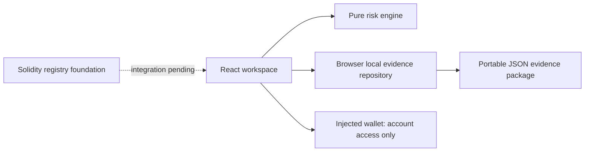

# Aegis Protocol

A wallet-security and incident-response prototype inspired by Arc. Detect. Protect. Report. Recover.

## Run

Requires Node.js 20.19+.

```sh
npm ci
npm run dev
npm test
npm run build
```

Open the local Vite URL printed in the terminal. Production assets are generated in `dist/` and can be served by a static host.

## Working features

- Responsive dark protection dashboard and five task-focused workspace views.
- Injected Ethereum wallet connection (account access only; never requests transfers).
- Address validation and deterministic, explainable screening.
- Explicit demo threat fixture: `0x1111111111111111111111111111111111111111`.
- Local evidence reports, registry search, recovery incident capture and JSON export.
- Browser-local persistence with storage error handling.
- Unit tests covering invalid input, demo detection, unknown outcomes and unverified reports.
- Solidity registry source with challenge events, a two-day review window and reviewer-only resolution.

## Honest demo boundaries

This is a runnable prototype, not a finished production security service. Data lives in this browser, not a shared database. Wallet connection does not enforce or switch networks. The Arc label is the intended target, not a verified deployment. No transactions are intercepted or simulated. No live intelligence, IPFS upload, USDC staking, issuer API or fund tracing is connected. The contract is not deployed, audited or wired into the UI; no contract test suite is included yet. There is no guarantee of safety or recovery. Unknown addresses are never labeled safe. The seeded address is a synthetic demo fixture, not an accusation against an actual owner.

## Architecture



`src/main.jsx` owns workspace interactions, `src/risk.js` isolates screening policy, and `contracts/AegisRegistry.sol` defines the registry lifecycle. Styling is centralized in `src/style.css`.

The initial frontend uses React/Vite to provide a reproducible standalone demo. The larger Next.js/Express/PostgreSQL/Prisma/Redis stack from the brief is not implemented. Production migration should separate feature components and introduce a durable authenticated API before shared reporting.

## Production integration sequence

1. Add wallet nonce authentication, durable PostgreSQL storage, authorization, request size limits and rate limits.
2. Add evidence content hashing and opt-in IPFS publication; warn that public evidence cannot be recalled.
3. Implement and test staking with a vetted token library. Keep Arc native gas units separate from ERC-20 USDC units.
4. Review and test contract invariants, access control, dispute handling and economic abuse. Replace the trusted reviewer with documented governance; this prototype is not decentralized adjudication.
5. Deploy reviewed contracts using a funded testnet wallet and publish verified addresses. Never put private keys in the client.
6. Integrate chain indexing and simulation. Treat unavailable upstream data as unknown, not safe.
7. Add authorized issuer coordination and distinguish draft, submitted, acknowledged and resolved states using actual provider responses.

## Privacy and security

Evidence can contain sensitive information and is readable by anyone with access to the same browser profile. Do not paste secrets, seed phrases or private keys. No analytics or external data uploads are built in. JSON exports contain user-submitted allegations and explicitly indicate that no issuer request has been sent. Only authorized issuers can freeze eligible assets.

## Demo walkthrough

1. Open Overview and choose Try a demo threat.
2. Screen any other syntactically valid address to see an Unknown result.
3. Add a report with at least 20 characters of supporting context.
4. Search its address in Threat registry; it remains Under review.
5. Open a recovery incident with a valid transaction hash and export its evidence.

## Reference

Arc network identifiers should be verified against Circle's maintained integration documentation before deployment: https://github.com/circlefin/skills/blob/master/plugins/circle/skills/use-arc/SKILL.md
